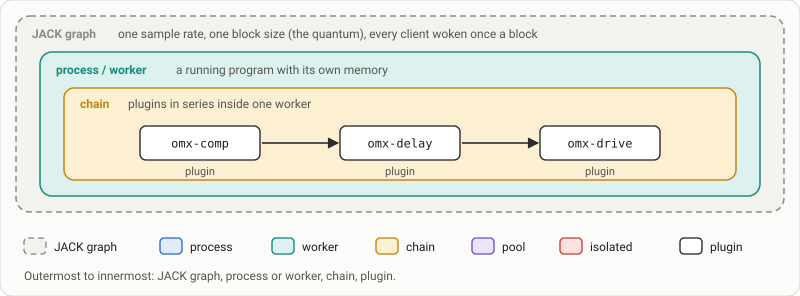
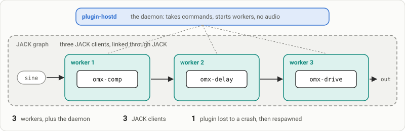
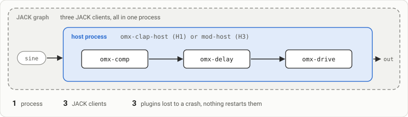
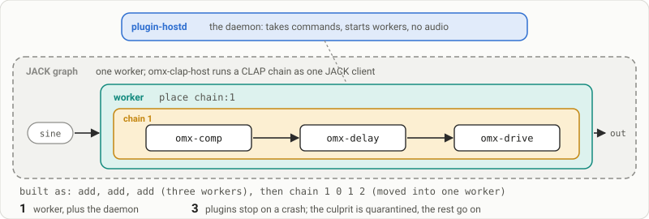
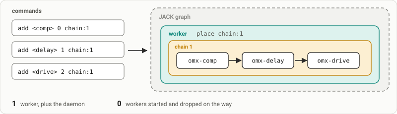
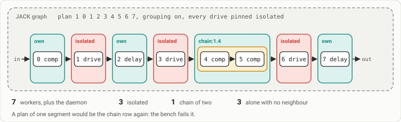
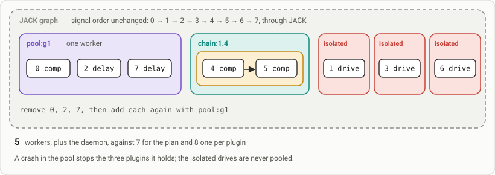

How plugins are grouped
=======================

The same plugins can be packed into processes in different ways. Each way trades CPU and memory against safety: how
much else stops when one plugin crashes. This page names the pieces, draws the six arrangements the benchmark measures,
and says what each benchmark row measures. The exact rules are in the [guide](guide.md); the benchmark itself is
[bench/README.md](../bench/README.md).

The words
---------

The pieces always nest in the same order, and every drawing on this page uses the same colours: the JACK graph dashed
grey, a process blue, a worker teal, a chain amber, a pool violet, a worker of an isolated plugin red, a plugin a white
chip.

- **JACK graph.** The audio server that moves sound between programs, one block of samples at a time, at one sample
  rate (48000, 96000) and one block size, the quantum (64, 128, 256 frames). Every program on it is a JACK client with
  ports of its own, and every block JACK wakes the clients in the order of the links. A block that is not done in time
  is an xrun, an audible click.
- **Plugin.** One effect or instrument: a compressor, a delay, a synth. It is a library in the CLAP or LV2 format, not
  a program, so it runs only inside a host.
- **Process.** A running program with memory of its own. A plugin that crashes kills its process, and every other
  plugin in that process with it. More processes give more isolation, and cost more memory and more switching between
  them every block.
- **Worker.** A process plugin-hostd starts to run plugins: omx-clap-host for CLAP, and for LV2 through its adapter, or
  mod-host for LV2 when `lv2_worker` names it ([Who runs an LV2 plugin](guide.md#who-runs-an-lv2-plugin)). The daemon
  only takes commands and starts and restarts workers; audio never passes through it. The placement of each `add`, a
  `chain` or a `plan` says which plugins a worker holds.
- **Chain.** Plugins in series inside one worker, declared by `chain` or by a segment of a `plan`. A worker that runs a
  chain in one JACK client (omx-clap-host) passes the sound from one plugin to the next in memory; one that does not
  (mod-host) keeps a client per plugin. One crash stops the whole chain.
- **Pool.** A shared worker named by the placement `pool:<name>`. It takes plugins that may share a worker wherever they
  sit in the signal path, so each does not need a worker of its own. A full pool, `pool_max` instances (8 by default),
  opens a sibling, `<name>#2`.

Two more words matter. A **host** is the program that loads the plugins; the benchmark compares four (below). A
**pin** is what plugin-hostd holds for each plugin: the SHA-256 of its files, its parameter layout and, once the
qualification has checked the plugin for crashes and real-time safety, a verdict ([Pins](guide.md#pins)). While pins
are checked, only a plugin whose pin says `verdict=in-process` may share a worker. `verdict=isolated` keeps it alone,
and so does a pin with no verdict yet. `verdict=refused` is not loaded at all.

The four hosts
--------------

| In the bench | Host | What it is | Formats |
|---|---|---|---|
| H1 | omx-clap-host | OpenMixer's host: one process holding every plugin, driven over the mod-host protocol. | CLAP, and LV2 through its adapter |
| H2 | plugin-hostd | The daemon: plugins in workers it supervises, alone or grouped in chains, plans and pools. Its workers are omx-clap-host. | CLAP and LV2 |
| H3 | mod-host | The MOD project's host: one process holding every plugin. | LV2 |
| H4 | jalv | A minimal host: one process per plugin, always. | LV2 |

The six arrangements
--------------------

The first four drawings run the same three plugins, omx-comp, omx-delay and omx-drive, between the test signal (a sine,
or chords for an instrument) and the output. The plan and the pool are drawn on the eight plugins of the `grp8`
scenario, since a plan needs isolated plugins to cut it.

### Individual

H2 with placement `own`; H4 (jalv), always.

Every plugin gets a process of its own, and the sound goes out through JACK and back in between each plugin. Under
plugin-hostd the processes are workers and the daemon stands beside them; jalv runs one process per plugin with nothing
above them.

- Processes: one per plugin (3), plus the daemon under plugin-hostd. JACK clients: 3.
- A crash: stops one plugin. plugin-hostd starts its worker again and puts back the links it made; a jalv that dies
  stays dead.
- The trade-off: the safest and the most expensive. Three programs in memory, and JACK switches between three
  processes every block.

### Shared process

H1 (omx-clap-host) and H3 (mod-host).

One host program holds every plugin. Each plugin is still a JACK client of its own inside that process, and the host
links them in series through JACK.

- Processes: 1. JACK clients: 3.
- A crash: stops all three, and nothing starts the host again. The `kill1` scenario ends `failed` with the note
  `host process lost` for H1, H3 and H4.
- The trade-off: the cheapest in memory and in switching. One faulty plugin takes the whole host down.

### Chain

H2, `chain 1 <instances>`.

plugin-hostd first adds each plugin in a worker of its own, then `chain` moves them all into one worker: each member's
state is saved, it is removed from its worker and replayed in the chain's. The daemon stays outside the sound path and
only gives orders.

- Processes: one worker, plus the daemon. JACK clients: 1 for a CLAP chain under omx-clap-host.
- A crash: stops the chain. The daemon starts the worker again, the member that crashed it is quarantined to a worker of
  its own, and the chain goes on without it until `quarantine_clear`.
- The trade-off: as cheap as a shared process, run by a supervisor that restarts it.

### Chain, added in place

H2, each plugin added with `add <uri> <instance> chain:1`.

The same result as a chain, built another way: each plugin is added straight into the chain's worker and never gets a
worker of its own first. This row measures what it costs to build the chain, not only to run it. A plugin the chain
refuses (a width its head does not take) is added `own` instead, as Zynthian adds it, and the row's note says how many.

- Processes: one worker, plus the daemon, plus one per plugin added `own`. Workers started and dropped on the way: 0.
- A crash: as for a chain.
- The trade-off: a chain's running cost, with no worker started and stopped while the strip is built.

### Plan

H2, `grouping on`, pins checked, a verdict per plugin, then `plan 1 <instances>`.

plugin-hostd's planner reads each plugin's pin and cost, and its running history on this machine, and decides which
runs of consecutive plugins share a worker. A run of two or more becomes a chain of place `chain:1.<k>`, `k` counting
the segments from 0. A plugin that shares with no neighbour, an isolated one among them, is placed `own`. `plan_get`
says why each plugin was left alone ([data/grouping.json](../data/grouping.json) lists the reasons). With the setting
`grouping` off, the default, the plan is only answered and nothing moves.

`grp8` runs comp, drive, delay, drive, comp, comp, drive, delay, with every drive pinned isolated and the rest
in-process. By the rules above that is seven segments: the two comps that sit next to each other share a worker, each
drive is alone, and three plugins are alone because both their neighbours are isolated drives.

- Processes: one worker per segment (7 for `grp8`), plus the daemon.
- A crash: stops the segment it happens in. An isolated plugin takes down only itself.
- The trade-off: the isolation the pins ask for, and sharing everywhere else. A plan that comes back as one segment
  is a `failed` row, since nothing was left for the pins to cut and it would repeat the chain row.

### Pool

H2, the same plan, then `pool:g1`.

Start from the plan. Every plugin the plan left in a worker of its own but whose pin lets it share is removed and added
again with the placement `pool:g1`, so they all move into one shared worker. The isolated plugins stay alone. The row
fails unless the daemon forms the pool from exactly the plugins moved into it.

- Processes: 5 workers for `grp8` instead of 7 for the plan and 8 one per plugin, plus the daemon.
- A crash: in the pool, stops every plugin it holds; in an isolated worker, only that plugin.
- The trade-off: the fewest processes that still respect every pin. The signal still flows through JACK in the
  strip's order; the pool only changes which worker holds each plugin. One strip is one chain, so the pool holds that
  strip's leftovers.

`grp16` repeats the same five-plugin cycle over 16 plugins: 13 segments in the plan (three chains of two comps, six
isolated drives, four plugins alone) and 10 workers once those four share the pool.

The comparison
--------------

The benchmark compares five rows. Four hosts make five because omx-clap-host is measured on both of its formats, and
plugin-hostd both one plugin per worker and grouped. In the documents `bench/run.sh` writes, each of these is one row per
scenario, mode, sample rate, block size and load.

| Row | Host | Arrangement | Scenarios |
|---|---|---|---|
| 1. jalv | H4 | individual | `cvc3` to `cvc48` and `cvl3` to `cvl48`, both with the LV2 builds |
| 2. mod-host | H3 | shared process | `cvc3` to `cvc48` and `cvl3` to `cvl48`, both with the LV2 builds |
| 3. omx-clap-host, CLAP | H1 | shared process | `cvc3` to `cvc48` |
| 4. omx-clap-host, LV2 adapter | H1 | shared process | `cvl3` to `cvl48` |
| 5. plugin-hostd, single and grouped | H2 | individual, chain, chain added in place; plan and pool | `cvc` (CLAP) and `cvl` (LV2 through the adapter); `grp8`, `grp16` (CLAP) |

jalv and mod-host run LV2 only, so under the CLAP scenarios they take the LV2 builds of the same plugins and the row's
note says so. Every `cvcN` has its `cvlN`: under H1 and H2 the pair is the same host, the same plugins and the same
DSP code in two wrappers, the clean read of the format.

The two families, from the `modes` table of [bench/scenarios.json](../bench/scenarios.json):

- **Chains vs processes.** `cvc3` to `cvc48` (CLAP) and `cvl3` to `cvl48` (LV2): 3, 8, 16, 24, 32 and 48 plugins
  cycling omx-comp, omx-delay and omx-drive. Rows: plugin-hostd individual, chain and chain added in place;
  omx-clap-host and mod-host shared; jalv individual. It asks how much grouping saves, and how the hosts compare on the
  same plugins.
- **Grouping vs processes.** `grp8` and `grp16`: 8 and 16 CLAP plugins cycling omx-comp, omx-drive, omx-delay,
  omx-drive, omx-comp, every drive pinned isolated, under plugin-hostd only. Rows: individual, chain, plan and pool. It
  asks whether the planner keeps the isolation the pins ask for while costing close to a full chain.

The individual and chain rows run with `require_pins 0`; the plan and pool rows with pins on, the daemon's own pin
store holding the verdicts and no package pins. Other scenarios (`cvp`, mixed CLAP and LV2; `tp10`, third-party LV2
effects) are listed in [bench/README.md](../bench/README.md#scenarios).

What each row measures
----------------------

The first four figures are the ones to compare first; the rest explain them. The field names are those of the
`omx-bench/1` document ([Reading the numbers](../bench/README.md#reading-the-numbers)).

| Figure | Field | Meaning |
|---|---|---|
| dsp % | `dsp_load_avg`, `dsp_load_max` | JACK's DSP load as the server computes it, read once a second over the window: how much of each block's time goes to processing. Higher means less room before clicks. |
| rss MB | `rss_mb_total` | resident memory of all the row's processes together, at the end of the window |
| add ms | `add_ms` | from the first `add` to the last reply; for a chain and a chain added in place, until the chain runs; for jalv, until the last client is in the graph. How long building the strip takes. |
| xruns | `xruns` | blocks that came too late in the window: JACK's xrun callbacks, counted by a client of the run's own server, and the server's own log; the larger of the two |
| latency | `latency_frames` | the capture latency JACK reports at `system:playback_1`, the longest of its range: the delay from the source to the output as the clients on the path declare it, in frames. Divide by the sample rate for time: 256 frames at 48000 Hz is 5.3 ms. It is declared, not a measured round trip; a host that declares none adds none. |
| processes, JACK clients | `processes`, `jack_clients` | how many programs the row runs (the host and every descendant, plugin-hostd's workers included), and how many clients it put on the JACK graph. This is where the arrangements differ most visibly. |
| rss, pss MB | `rss_mb`, `rss_mb_total`, `pss_mb_total` | rss counts a shared library once in every process that maps it, so many processes look larger than they are; pss shares those pages out between the processes, the honest figure for real memory |
| cpu % | `cpu_pct` | user and system time of the row's processes over the window, in percent of one core, beside JACK's own DSP load |
| context switches | `ctx_switches`, `ctx_involuntary`, `ctx_jackd`, `ctx_jackd_involuntary` | how often the row's threads were switched out, and how many of those switches were involuntary; then the same for the JACK server, since a graph of more clients costs it switches too |
| recover ms | `recover_ms` | in the `kill1` scenario: from `kill -9` of the process that holds the plugin until its client is back and wired as before. Only plugin-hostd recovers; the other hosts lose their process. |
| output level | `output` | one second of the strip's output recorded with `jack_rec`, its level in dB. A silent row is not a pass, and under H1 and H2 a row whose level differs by more than 1 dB from the same plugins run one per worker is marked unstable. |

Every row runs at each sample rate and block size of the run (48000 and 96000 Hz, 128 and 256 frames by default), and
the scenarios above run twice: on a quiet machine, and beside a stress load, one busy loop pinned to each core the host
may use and a process that keeps touching 256 MiB. Each row runs three times by default, with the hosts interleaved
(A B C A B C), and the document keeps the median and the spread. A row whose DSP load repeats span more than 10 % of
their median (and more than 0.3 points) is run once more on its own, and if it still does, it is marked unstable and no
ratio is made from it. The same holds for the other checks of [the soundness gate](../bench/README.md#the-soundness-gate):
twins, stress, scaling, machine state and output.

The private JACK server of a run uses the dummy driver unless `--alsa hw:X` names an audio interface, and it never
touches a JACK server already running on the machine.
